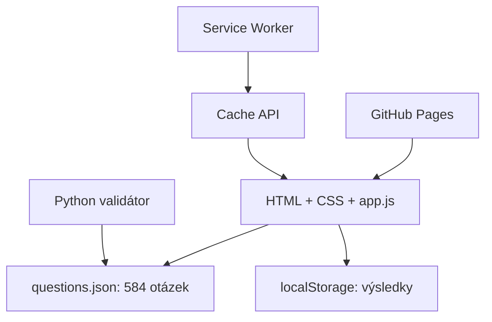

# Architektura HAREC do kapsy v0.8

## Princip

Jednostránková statická webová aplikace (PWA). Nevyžaduje serverové prostředí, přihlášení ani živé API HamOtazky.cz. Hostuje se na GitHub Pages a funguje v prohlížeči i jako instalovatelná PWA.



## Klíčové soubory

| Soubor | Úloha |
|---|---|
| `index.html` | Přístupné rozhraní: úvod, nastavení, otázka, výsledky, informace |
| `styles.css` | Responzivní vzhled, klikací plochy, styly správné/chybné odpovědi |
| `app.js` | Načtení JSON, režimy, výběr a míchání otázek, vyhodnocení, export, detekce aktualizací |
| `questions.json` | Lokální obsah otázek HAREC třídy A |
| `manifest.json` | Údaje pro instalaci PWA a ikony |
| `sw.js` | Přednačtení aplikace, cache-first offline provoz, správa verzí |
| `scripts/validate_questions.py` | Strukturální kontrola obsahu mimo běžící aplikaci |

## Datový model

Každá otázka má `id`, `code`, `question`, `group`, `topic`, `options` (přesně 3 textové možnosti) a `correct` (index 0–2). Identifikátory mají v této verzi tvar `ham-...`. `correct` není text odpovědi ani číslo 1–3, ale index v poli počítaný od nuly.

JSON je načítán metodou `fetch('./questions.json')`. Při načítání se ověřuje počet 584, tři odpovědi a platný index správné odpovědi. Python validátor přidává další strukturální kontroly.

## Stav a migrace

Uživatelský pokrok se ukládá do `localStorage` pod **`harec-ham-A-v07`**. I ve v0.8 zůstává klíč nezměněný, aby předchozí výsledky nebyly ztraceny. Struktura:

```json
{"total":12,"correct":9,"wrong":["ham-1","ham-34"]}
```

`total` je počet vyhodnocených pokusů, ne počet unikátních otázek. `wrong` obsahuje unikátní ID posledních nevyřešených chyb. Starší `harec-v1` zůstává mimo tento stav a je zobrazena pouze archivní informace, pokud existuje.

**Pozor:** `localStorage` je vázané na origin / kontext prohlížeče. Vymazání dat webu může statistiky odstranit. Export je možný, ale import zpět dosud není součástí produktu.

## Aktualizace a mezipaměť

`sw.js` předem ukládá všech 8 souborů do pojmenované cache. Při vytvoření nové verze **je nutné změnit hodnotu `CACHE`**. Nový service worker čeká, dokud uživatel nepotvrdí aktualizaci přes rozhraní (pokud má otevřeného stávajícího klienta); poté zavolá `skipWaiting()` a klient znovu načte stránku. Offline provoz používá strategii cache-first a při úspěšných odpovědích ukládá další zdroje stejného originu.

Výhoda: aplikace funguje offline. Nevýhoda: bez správného verzování cache se může zobrazovat starý kód. Nemažte localStorage jako metodu aktualizace.

## Bezpečnost a soukromí

Text otázek se vkládá pomocí `textContent` / textových uzlů, nikoliv `innerHTML`, aby importovaná data nemohla být vyhodnocena jako HTML. Výjimkou je pouze pevně generovaný číselný údaj v domácím přehledu, který není převzat z databáze. Data se neodesílají na náš server. Odkazy na externí zdroje fungují pouze při připojení k internetu.

## Budoucí rozšíření

Výkladové komentáře a odkazy u jednotlivých otázek, testy regulérní struktury zkoušky, import zálohy, případně IndexedDB. Žádné z těchto rozšíření není ve v0.8 implementováno.
